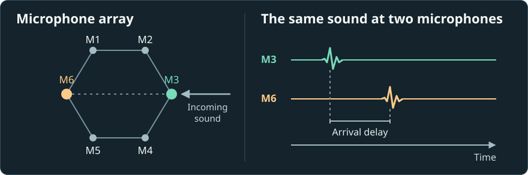
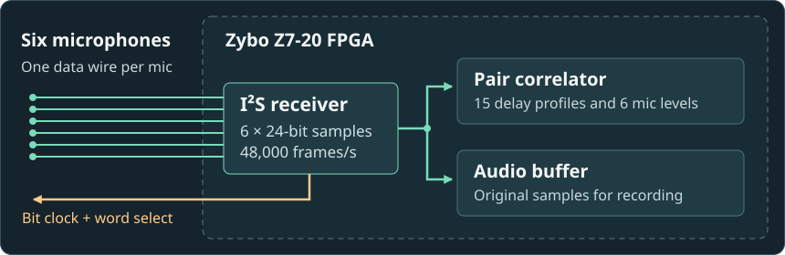
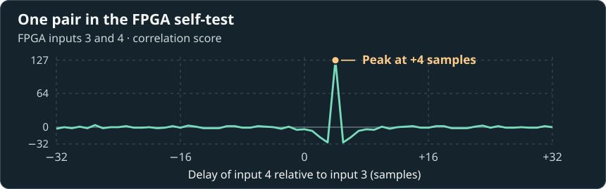
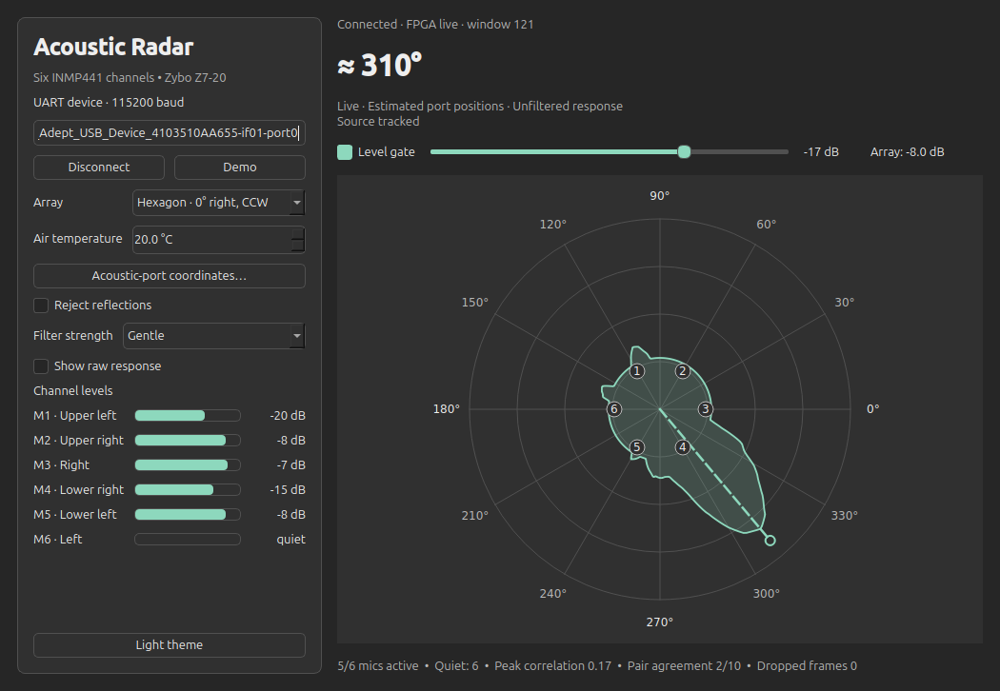
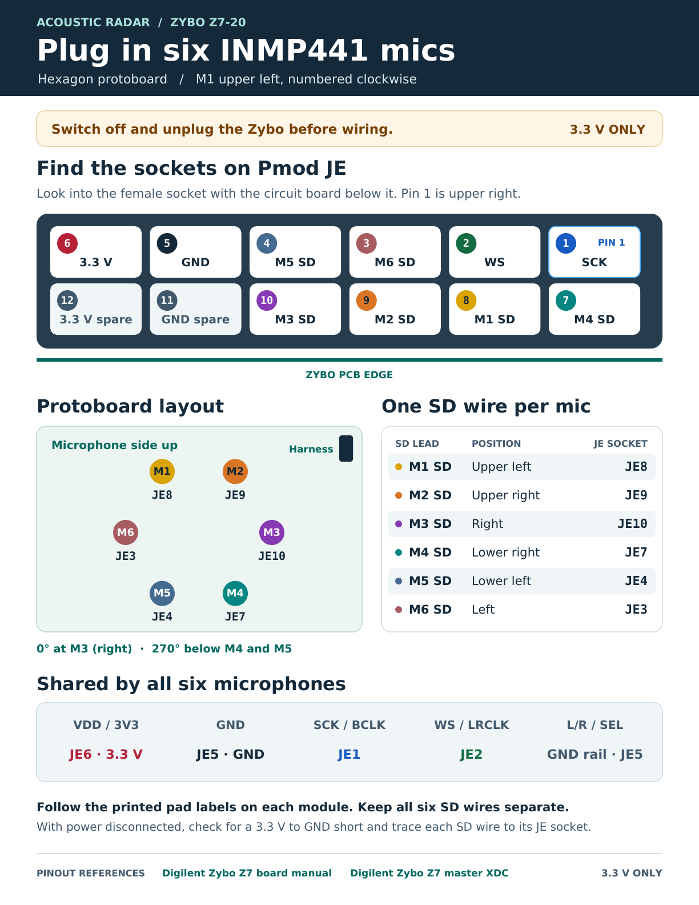

# FPGA Acoustic Radar

A stationary ring of six microphones estimates where a sound is coming from. Each microphone hears a guitar strum at a slightly different time. The FPGA measures those differences, and a desktop compass turns them into a horizontal bearing.

**Guitar tracking demo · 1:10**

Watch the guitar move around the array alongside the live compass. Across 69 detections in this take, the estimated bearing moved through a net 339°.

**[Watch the demo on mobile](https://rlongwell.github.io/fpga-acoustic-radar-public/)**

[](https://github.com/user-attachments/assets/79621489-bdd7-49d5-a1f6-ac23862a0c2a)

## How the array finds a direction



A strum to the right of the array reaches M3 before M6. That delay is one clue. Pairs facing other directions hear the same strum with different delays. The desktop uses the microphone positions to predict those delays for each compass direction and finds the bearing that best fits the FPGA’s measurements.

## What the FPGA does with the microphone inputs



**Capture all six microphones together.** The FPGA sends every microphone the same bit clock and word-select signal. It reads their six data wires in parallel, collecting one signed 24-bit sample per microphone 48,000 times a second. It also keeps a rolling buffer of the original samples for six-channel recording.

**Find where two waveforms line up.** For each microphone, the FPGA subtracts the previous sample from the current one to emphasize changes in the sound. For each of the 15 microphone pairs, it shifts one waveform against the other from −32 to +32 samples. At each shift it multiplies the aligned values and sums the products over 4,096 frames (about 85 ms). A peak marks a delay where the two signals match well.



In this board self-test, FPGA input 4 receives the test signal four samples after input 3. The measured peak at **+4 samples** recovers that delay, about **83 µs** at 48 kHz. During live capture, the FPGA publishes all 65 scores for every pair plus six channel energies. Linux passes those measurements to the desktop so it can weigh several possible delays when estimating the bearing. [Recorded self-test](verification/bench/board-self-test.log) · [Signal-processing details](docs/signal-processing.md)

## What the dashboard shows



In this live bench capture the compass reads **≈310°** and the sixth microphone is quiet. The green lobe points toward the estimated bearing, and its radius shows how strongly the measurements support it. The meters show which channels are contributing. The level gate hides bearings during quiet passages, and optional reflection filtering helps when more than one direction fits. With a connected array you can record the six audio channels and bearings together, replay a strum, or export a synchronized clip.

## Try it

1. **Wire the microphones with the Zybo powered off.** Use six INMP441 breakouts on a hexagon. With the harness at the upper right, M1 is upper left and M2–M6 follow clockwise. Connect all VDD pins to **JE6 (3.3 V)**, GND and L/R to **JE5 (ground)**, SCK to **JE1**, and WS to **JE2**. Grounding L/R selects the left I²S slot. Connect the six separate SD (data) wires in **M1–M6 order to JE8, JE9, JE10, JE7, JE4, JE3**. Looking into the female JE socket with the board below it, pin 1 is at the upper right.

   

   [Printable wiring diagram (PDF)](wiring/six_microphone_hexagon_plug_in_guide.pdf) · [Mic positions and pin table](docs/hexagon.md)

2. **Prepare a radar card on Ubuntu 24.04.** Clone the repository and run the helper below. It downloads Digilent’s pinned Zybo boot files and builds a 65 MiB microSD image with the released FPGA bitstream. A fresh RTL build is optional.

   ```sh
   sudo apt update
   sudo apt install git curl python3-venv psmisc libxcb-cursor0 gnome-disk-utility \
     xilinx-bootgen u-boot-tools cpio dosfstools mtools fdisk
   git clone https://github.com/rlongwell/fpga-acoustic-radar-public.git
   cd fpga-acoustic-radar-public
   ./scripts/prepare-sd.sh
   ```

3. **Boot the board.** In Ubuntu **Disks**, select a spare microSD card and use **Restore Disk Image…** with `build/radar-sd.img`. This replaces the contents of the selected card. Eject it, insert it with board power off, set **JP5 to SD**, and connect **J12 (PROG/UART)** to the PC with a micro-USB data cable. Power on. U-Boot loads the bitstream from the card at each boot.

4. **Open the live compass.** From the repository root, run the command below. Select **Hexagon · 0° right, CCW** and play speech or music beside M3. Look for moving microphone meters and a bearing near **0°**. Move the source toward the bottom edge between M4 and M5 to try **270°**.

   ```sh
   ./dashboard.sh --port auto
   ```

For a **software-only demo**, run `./dashboard.sh --demo` to explore the compass with simulated sound.

## Platform and tools

| Component | Environment |
| --- | --- |
| Desktop compass | Ubuntu 24.04 LTS x86-64, Python 3.10+, PySide6 and pyserial. The launcher installs the Python dependencies in a local virtual environment. |
| Hardware | Digilent Zybo Z7-20 (Zynq-7020), six INMP441 microphones, Pmod JE. The starter card uses embedded ARM Linux 5.15.19 and USB UART. |
| FPGA build | AMD Vivado **2024.2**, Zynq-7000 device support and the included Digilent board preset. Verilator runs the RTL tests. The released bitstream can be used without Vivado. |

See the [starter-card guide](docs/starter-card.md) for rebuilding the bitstream, checking the USB port and testing the board. The [signal-processing guide](docs/signal-processing.md) explains how a bearing is calculated, and the [operator guide](docs/radar.md) covers network streaming and recording.
